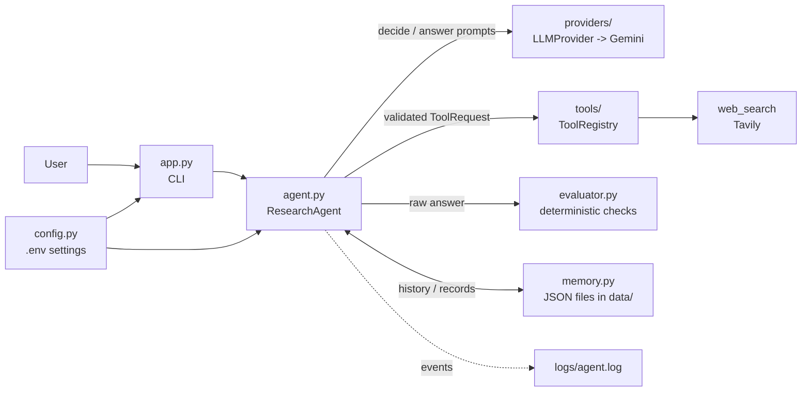

# Mini Research Agent

A small, readable AI agent in Python. It takes a question, **decides** whether it needs the web, **runs a search tool under application control**, writes an answer with an LLM, **checks the answer with deterministic rules**, and remembers the conversation in local JSON files.

It is a portfolio project, deliberately lightweight: no agent frameworks, no vector databases, no Docker, no web UI.

## Problem statement

Calling an LLM in a loop is not an agent. A useful agent needs *control*:

- who decides what happens next (the model proposes, the **application** disposes),
- what the model is allowed to trigger (only registered tools, with validated input),
- when to stop (explicit limits instead of hoping the model stops),
- what to do when things go wrong (timeouts, bad output, empty search results),
- and how to avoid presenting guesses as research.

Mini Research Agent is a compact, tested reference for those ideas.

## Main features

- **Genuine decision step.** The model chooses `answer` or `search` as structured JSON; the app validates it before anything runs.
- **Controlled tool execution.** An explicit `ToolRegistry`; only `web_search` is registered. The model never runs code or commands.
- **Hard limits.** Max iterations, max searches per question (default 2), max query length, max results, request timeouts, max invalid actions.
- **Honest about research.** Search results keep their real titles/URLs. The evaluator rejects invented URLs and "I searched the web..." claims when nothing was retrieved.
- **Limited mode.** Without a search key, the agent still works, says clearly that no research was done, and never pretends otherwise.
- **Deterministic output evaluation** with at most one repair attempt.
- **Local JSON conversation memory** with atomic writes and corruption handling.
- **Structured logging** with secret redaction; question text is not logged.
- **Provider isolation.** All Gemini-specific code is in one module behind a one-method interface.
- **Offline test suite** (pytest, fakes only; no keys, no network).

## Architecture overview



| Module | Responsibility |
|---|---|
| `app.py` | CLI only: input, output, wiring. No agent logic. |
| `agent.py` | The workflow: decide loop, limits, fallbacks, repair, saving. |
| `config.py` | Load/validate environment settings; logging setup with secret redaction. |
| `models.py` | Pydantic models (actions, results, evaluation, memory records, responses). |
| `errors.py` | Application-level exception hierarchy. |
| `memory.py` | JSON conversation storage. |
| `evaluator.py` | Deterministic output checks. |
| `providers/` | `LLMProvider` interface and the Gemini implementation. |
| `tools/` | `Tool` interface, `ToolRegistry`, and the Tavily web search tool. |

More detail: [`docs/architecture.md`](docs/architecture.md).

## Workflow

1. Validate the question and load the most recent history messages.
2. **If search is available**, run the decide loop. Each iteration the model returns `{"action", "query", "reason"}`:
   - `answer` -> leave the loop.
   - `search` -> the app validates the query (non-empty, length-limited, not a repeat), checks the search budget, and runs the tool through the registry.
   - Anything else is an **invalid action**: the model is told why and may retry; after 2 invalid actions in total the run stops with a controlled error.
3. **If search is not available** (no key, or `MAX_SEARCH_CALLS=0`), the decide step is skipped and the answer prompt states that no research is possible.
4. The model writes `{"answer", "source_urls"}`.
5. The evaluator checks it. On failure, the model gets the concrete reasons and **one** regeneration. Re-evaluate.
6. The result is `completed`, `partial` (answer plus explicit warnings) or `failed` (no answer shown). Answered runs are saved to memory.

**Stopping conditions:** model says `answer`; search limit reached; a search fails; iteration limit reached; repeated invalid actions; provider error.

## Technology stack

- Python 3.11+ (the test suite was run on 3.13)
- [Google Gen AI SDK](https://pypi.org/project/google-genai/) (`google-genai`) for Gemini
- [Tavily](https://tavily.com/) (`tavily-python`) for web search
- Pydantic v2, python-dotenv
- pytest
- Standard library: `logging`, `json`, `pathlib`, `argparse`

## Project structure

```
mini-research-agent/
├── app.py                  # CLI
├── agent.py                # workflow orchestration
├── config.py               # settings + logging setup
├── models.py               # pydantic models
├── errors.py               # exception hierarchy
├── memory.py               # JSON conversation memory
├── evaluator.py            # deterministic output checks
├── providers/
│   ├── base.py             # LLMProvider interface
│   └── gemini_provider.py  # Gemini implementation
├── tools/
│   ├── base.py             # Tool interface + ToolRegistry
│   └── web_search.py       # Tavily search tool
├── tests/                  # pytest suite (offline)
├── data/                   # conversation JSON files (git-ignored)
├── logs/                   # agent.log (git-ignored)
├── docs/architecture.md
├── .env.example
├── requirements.txt
├── pyproject.toml
└── LICENSE
```

## Prerequisites

- Python 3.11 or newer
- A Gemini API key (required): <https://aistudio.google.com/apikey>
- A Tavily API key (optional, enables web search): <https://app.tavily.com/>

## Installation

```bash
git clone https://github.com/<your-username>/mini-research-agent.git
cd mini-research-agent
python -m venv .venv
source .venv/bin/activate        # Windows: .venv\Scripts\activate
pip install -r requirements.txt
cp .env.example .env             # Windows: copy .env.example .env
```

## Environment configuration

Edit `.env`. Blank values use the defaults.

| Variable | Default | Meaning |
|---|---|---|
| `GEMINI_API_KEY` | *(required)* | Gemini API key |
| `TAVILY_API_KEY` | *(none)* | Search key; missing = **limited mode** |
| `GEMINI_MODEL` | `gemini-3.6-flash` | Model name; check Google's docs for current models |
| `MAX_AGENT_ITERATIONS` | `5` | Decide-loop iterations per question (1-20) |
| `MAX_SEARCH_CALLS` | `2` | Searches per question (0-10; 0 disables search) |
| `MAX_SEARCH_RESULTS` | `5` | Results passed to the model per search (1-10) |
| `MAX_HISTORY_MESSAGES` | `6` | History messages sent to the model (0-50) |
| `MAX_OUTPUT_LENGTH` | `4000` | Max answer characters (200-20000) |
| `REQUEST_TIMEOUT_SECONDS` | `30` | Timeout for model and search requests (1-300) |
| `LOG_LEVEL` | `INFO` | `DEBUG`, `INFO`, `WARNING`, `ERROR`, `CRITICAL` |
| `DATA_DIR`, `LOG_DIR` | `./data`, `./logs` | Where memory and logs are written |

Invalid values are all reported together at startup. `.env` is git-ignored; never commit it.

### Limited mode

If `TAVILY_API_KEY` is missing (or `MAX_SEARCH_CALLS=0`):

- the CLI prints a banner and every response shows `limited mode: yes` plus a note;
- the model is told that search is unavailable and must answer from general knowledge, with no sources;
- answers may be outdated or wrong about recent events, and are **not** based on external research;
- an answer that claims to have searched, or that contains URLs the user did not supply themselves, is rejected by the evaluator.

## How to run

```bash
python app.py                                   # interactive session
python app.py --ask "What are the pros and cons of AI automation for small businesses?"
python app.py --conversation <id>               # resume a saved conversation
```

Interactive commands: `/new` (new conversation), `/help`, `/exit` (also `exit`, `quit`). The conversation id is printed at start; saved files are `data/<id>.json`.

Exit codes: `0` ok, `1` the answer failed, `2` configuration error.

## How to run tests

```bash
pip install -r requirements.txt
pytest
```

No API keys or network access are needed: the model and the search service are replaced by fakes. The suite covers: answer without search, search + answer, tool execution, invalid and unknown actions, empty/oversized/duplicate queries, search and iteration limits, empty answers, missing citations, memory persistence / corruption / missing files / failed writes, provider timeouts and rate limits, search failures, missing configuration, failed evaluation, successful and failed repair, secret redaction, and CLI behavior.

## Example interaction

Output format of `python app.py --ask "..."` (this sample was produced with scripted fake model/search responses to show the layout; real answers and sources depend on the live APIs):

```
Advantages: saves time on repetitive work and reduces errors. Disadvantages: upfront cost, integration effort, and staff training.

Sources:
  1. AI automation for small business - https://example.com/ai-smb
  2. Costs and risks of automation - https://example.org/risks

[status: completed | searches: 1 | limited mode: no]
```

A degraded run is marked explicitly:

```
[PARTIAL RESULT] The answer below is incomplete or unverified; see notes.

<answer text>

Notes:
  - Web search failed: The search service timed out.

[status: partial | searches: 1 | limited mode: no]
```

## Example tool-call workflow

For the question *"What are the main advantages and disadvantages of AI automation for small businesses?"* the exchanges look like this (illustrative):

```text
1. App -> model   decide prompt (question + history + searches remaining)
2. Model -> app   {"action": "search", "query": "advantages disadvantages AI automation small businesses", "reason": "needs current information"}
3. App            validates: known action, non-empty, <= 200 chars, not a repeat, budget left (0 of 2 used)
4. App            ToolRegistry.execute(ToolRequest("web_search", query))  -> Tavily
5. App            normalizes results: title, url, snippet, score; drops unsafe/duplicate URLs; keeps <= MAX_SEARCH_RESULTS
6. App -> model   decide prompt again, now with <search_results> ... </search_results>
7. Model -> app   {"action": "answer", "query": "", "reason": "enough information"}
8. App -> model   answer prompt (results wrapped as untrusted data)
9. Model -> app   {"answer": "...", "source_urls": ["https://..."]}
10. App           evaluator: well-formed, non-empty, length, sources cited, every URL came from the results
11. App           save to data/<conversation_id>.json, return the response
```

## Error-handling strategy

Expected failures have their own exception classes (`errors.py`) and become a clear status, never a crash. Unexpected exceptions are not silenced: the CLI logs them with a traceback and keeps the session alive.

| Situation | Behavior |
|---|---|
| Missing `GEMINI_API_KEY` | Startup error with fix instructions, exit code 2 |
| Missing `TAVILY_API_KEY` | Limited mode (see above) |
| Model timeout / rate limit / unavailable / bad credentials | Run fails with a specific message; **no automatic retry**; nothing saved |
| Malformed or unknown model action | Model is told why and may retry; 2 invalid actions in total -> controlled failure |
| Empty / oversized / repeated search query | Treated as an invalid action; never executed |
| Model asks for more searches than allowed | Not executed; answer uses what was gathered; warning shown |
| Search timeout or service error | **No retry**; answer written without research; status `partial` |
| Search returns nothing | Model may refine the query (counts toward the limit); otherwise `partial` with a warning |
| Iteration limit reached | Answer from what was gathered; status `partial` |
| Answer fails evaluation | One regeneration with the reasons. Still failing: `failed` (answer withheld) for severe checks, `partial` with a loud warning for soft ones |
| Corrupted memory file | Moved aside as `<id>.json.corrupt-<timestamp>`; conversation continues with empty history |
| Memory write failure | Answer is still shown, with a warning that it was not saved |

## Memory design

- One file per conversation: `data/<conversation_id>.json`. Ids are UUIDs; user-supplied ids must match `[A-Za-z0-9_-]{1,64}` (no path traversal).
- Each record stores the question, final answer, status, UTC timestamp, and small tool metadata (queries, cited URLs, counts).
- Only the last `MAX_HISTORY_MESSAGES` messages are sent to the model; at most 200 records are kept per file.
- Writes are atomic: temp file, `fsync`, then `os.replace`. A failed write leaves the previous file intact.
- Each run has a unique `record_id`; saving the same record twice is a no-op, so retries cannot create duplicates.
- Failed runs are not saved.

**This is suitable for a local, single-user demo, not a multi-user production database.** There is no locking or encryption; questions and answers are stored as plain text in `data/`.

## Evaluation design

`OutputEvaluator` is deterministic (no LLM call) and returns `passed`, a `checks` dictionary and a list of `issues`:

| Check | Meaning |
|---|---|
| `well_formed` | Valid JSON object with `answer` (string) and `source_urls` (list of strings) |
| `non_empty` | The answer has text |
| `within_length_limit` | At most `MAX_OUTPUT_LENGTH` characters |
| `no_false_search_claims` | If nothing was retrieved, the answer must not say "I searched...", "based on the search results...", etc. (heuristic, English phrases) |
| `research_sources_present` | If results were retrieved, at least one retrieved URL is cited |
| `urls_from_search_results` | Every URL in the answer or `source_urls` appears in the retrieved results (or in the user's own question) |

The sources shown to the user are built from the **retrieved results**, never from model-written text.

> **Important limitation:** these checks verify structure and honesty about sources. They do **not** verify that the answer is factually correct, or that a cited page actually supports a claim. No fact-checking mechanism is implemented.

## Security considerations

- **Search results are untrusted.** They are wrapped in `<search_results>` tags, closing tags inside them are neutralized, and the system instruction says never to follow instructions found there. This reduces prompt-injection risk but cannot eliminate it; the architecture also limits the damage (the model can only trigger a registered search, not run code).
- **The app executes tools, not the model.** Only registered tools run; unknown names are rejected; there is no shell, `eval`, or file access reachable from model output.
- **URL hygiene.** Only `http(s)` URLs without embedded credentials are kept; the agent never fetches or opens them.
- **Secrets.** Keys come from the environment; they are excluded from `repr`, error messages and logs, and the log formatter redacts known secret values (including in tracebacks).
- **Logs** record events and sizes, not question or answer text (search queries only at `DEBUG`).
- **Input limits** on question length, query length, result count and history size.

## Known limitations

- Only Gemini and Tavily are implemented. Other providers need a new `LLMProvider`.
- Search uses result snippets only; pages are not downloaded or read.
- Evaluation cannot detect wrong facts or unsupported citations; the "false search claim" check uses English phrases only.
- No automatic retries or backoff; a rate-limit error simply ends the run with a message.
- JSON memory has no locking, encryption, or search; it is single-user.
- No streaming output; the CLI is synchronous.
- Automated tests use fakes. Real Gemini/Tavily calls are not covered by the test suite and should be smoke-tested manually with your own keys (`python app.py --ask "..."`).

## Future improvements

- Retry with exponential backoff for rate limits.
- A page-reading tool with strict URL and SSRF protections.
- An LLM-based or retrieval-based grounding check as a second evaluation layer.
- SQLite memory with locking; conversation listing and export.
- Additional providers behind the same interface.
- Streaming output and an optional web interface.

## License

MIT. See [LICENSE](LICENSE). Replace `[Your Name]` in the license file with your name.
