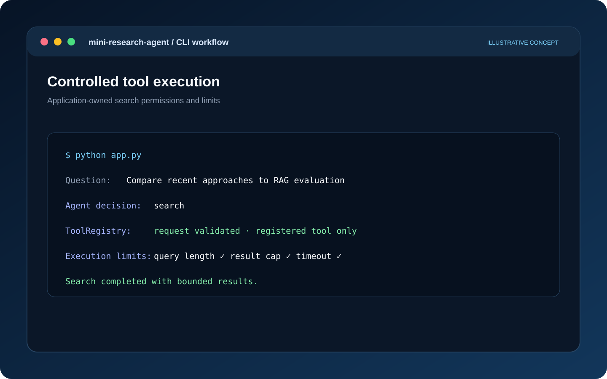
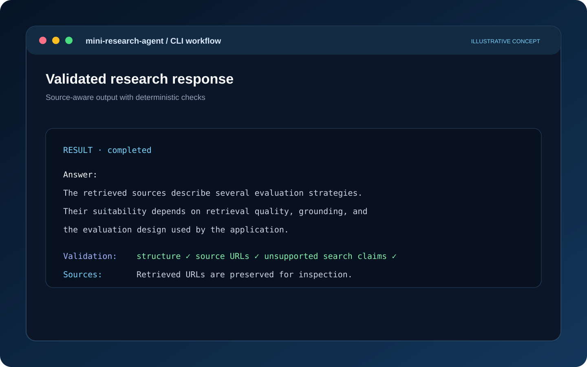
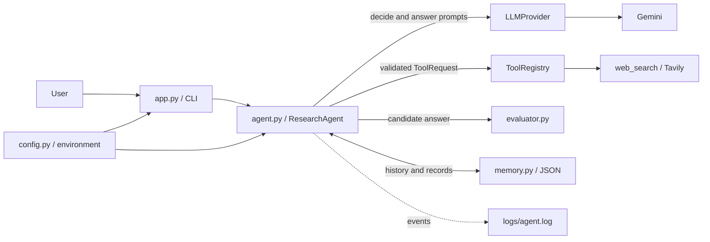

# Mini Research Agent

A lightweight, controlled AI research agent built with Python. Given a question, it decides whether web search is needed, invokes registered tools through application-controlled execution, generates an answer with an LLM, validates the output with deterministic checks, and stores conversation history in local JSON files.

This project focuses on **agent orchestration, tool governance, bounded execution, output validation, and reliable failure handling** without relying on an agent framework, vector database, Docker, or web UI.

## Engineering Goals

An LLM-driven workflow needs more than repeated model calls. The application must retain control over:

- **Decision-making:** the model proposes an action; the application validates and executes it.
- **Tool permissions:** only explicitly registered tools with validated inputs can run.
- **Execution boundaries:** iteration, search, query-length, result-count, and timeout limits are enforced.
- **Failure handling:** provider errors, invalid actions, timeouts, and empty search results produce explicit outcomes.
- **Research integrity:** the agent must not claim to have searched or cite URLs that were not retrieved.

Mini Research Agent is a compact, tested implementation of these principles.

## Key Features

- **Structured agent decisions:** the model selects `answer` or `search` using structured JSON that is validated by the application.
- **Controlled tool orchestration:** an explicit `ToolRegistry` executes only registered tools; the model cannot run shell commands or arbitrary code.
- **Bounded execution:** configurable limits for iterations, searches, query length, result count, request timeouts, and invalid actions.
- **Research-aware responses:** retrieved titles and URLs are preserved; invented URLs and unsupported claims of web research are rejected.
- **Limited mode:** the agent remains usable without a Tavily key and clearly states when no external research was performed.
- **Deterministic output evaluation:** structured checks validate the response, with at most one repair attempt.
- **Local conversation memory:** JSON-based persistence with atomic writes, corruption handling, and duplicate-record protection.
- **Security-conscious logging:** structured events, secret redaction, and no question/answer text in normal logs.
- **Provider isolation:** Gemini-specific integration is separated behind an `LLMProvider` interface.
- **Offline tests:** pytest suite using fakes; no API keys or network access required.

## Architecture

The CLI wires together the research agent, provider, tool registry, evaluator, and local memory. The model proposes decisions and answers, while the application retains responsibility for validation, tool execution, limits, and persistence.

## Workflow Preview

This project is a command-line agent rather than a web dashboard. The following illustrative terminal-style visuals explain its orchestration and safety boundaries; they are conceptual diagrams, not captured terminal output.

### Agent execution flow


### Controlled tool execution



### Validated research response





### Module Responsibilities

| Module | Responsibility |
|---|---|
| `app.py` | CLI input/output and application wiring |
| `agent.py` | Decision loop, execution limits, fallbacks, repair, and persistence |
| `config.py` | Environment loading, validation, and logging configuration |
| `models.py` | Pydantic models for actions, results, evaluation, memory, and responses |
| `errors.py` | Application-level exception hierarchy |
| `memory.py` | Local JSON conversation storage |
| `evaluator.py` | Deterministic response checks |
| `providers/` | LLM provider interface and Gemini implementation |
| `tools/` | Tool interface, registry, and Tavily search integration |

See [docs/architecture.md](docs/architecture.md) for additional design details.

## Agent Workflow

1. Validate the user's question and load the most recent conversation history.
2. When search is available, ask the model for a structured decision containing `action`, `query`, and `reason`.
3. If the action is `search`, validate the query, reject empty, oversized, or repeated queries, check the remaining search budget, and execute the registered tool through `ToolRegistry`.
4. If the action is `answer`, leave the decision loop and request a structured answer containing `answer` and `source_urls`.
5. Run deterministic output evaluation. If evaluation fails, provide the concrete issues to the model and allow one regeneration attempt.
6. Return a `completed`, `partial`, or `failed` result. Answered runs are saved to local conversation memory.

When search is unavailable because the Tavily key is missing or `MAX_SEARCH_CALLS=0`, the decision step is skipped. The answer prompt explicitly states that external research is unavailable.

**Stopping conditions** include a model decision to answer, search or iteration limits, search failures, repeated invalid actions, and provider errors.

## Technology Stack

| Area | Technology |
|---|---|
| Language | Python 3.11+ |
| LLM integration | Google Gen AI SDK (`google-genai`) with Gemini |
| Web search | Tavily (`tavily-python`) |
| Data validation | Pydantic v2 |
| Configuration | python-dotenv |
| Testing | pytest |
| Persistence | Standard-library JSON and filesystem APIs |
| CLI and utilities | argparse, logging, pathlib |

The test suite has also been run on Python 3.13.

## Prerequisites

- Python 3.11 or newer
- A Gemini API key (required): [Google AI Studio](https://aistudio.google.com/apikey)
- A Tavily API key (optional; enables web search): [Tavily](https://app.tavily.com/)

## Installation

### 1. Clone the repository

```bash
git clone https://github.com/reezanikeghbal-design/mini-research-agent.git
cd mini-research-agent
```

### 2. Create and activate a virtual environment

```bash
python -m venv .venv
```

**macOS / Linux**
```bash
source .venv/bin/activate
```

**Windows PowerShell**
```powershell
.venv\\Scripts\\Activate.ps1
```

### 3. Install dependencies

```bash
python -m pip install --upgrade pip
pip install -r requirements.txt
```

### 4. Configure environment variables

Create a local `.env` file:

**macOS / Linux**
```bash
cp .env.example .env
```

**Windows PowerShell**
```powershell
Copy-Item .env.example .env
```

Edit `.env` and provide your Gemini API key. Add a Tavily API key if you want to enable web search. Never commit `.env` or API credentials.

## Configuration

Blank values use the documented defaults.

| Variable | Default | Description |
|---|---|---|
| `GEMINI_API_KEY` | Required | Gemini API key |
| `TAVILY_API_KEY` | None | Search API key; missing key enables limited mode |
| `GEMINI_MODEL` | `gemini-3.6-flash` | Gemini model identifier; verify model availability with Google's documentation |
| `MAX_AGENT_ITERATIONS` | `5` | Decision-loop iterations per question (1–20) |
| `MAX_SEARCH_CALLS` | `2` | Searches per question (0–10); zero disables search |
| `MAX_SEARCH_RESULTS` | `5` | Maximum results passed to the model per search (1–10) |
| `MAX_HISTORY_MESSAGES` | `6` | History messages sent to the model (0–50) |
| `MAX_OUTPUT_LENGTH` | `4000` | Maximum answer length in characters (200–20,000) |
| `REQUEST_TIMEOUT_SECONDS` | `30` | Model and search request timeout (1–300) |
| `LOG_LEVEL` | `INFO` | Logging level |
| `DATA_DIR`, `LOG_DIR` | `./data`, `./logs` | Directories for conversation data and logs |

Invalid configuration values are reported together at startup.

### Limited Mode

If `TAVILY_API_KEY` is missing or `MAX_SEARCH_CALLS=0`:

- The CLI displays a limited-mode notice and each response indicates that external search was unavailable.
- The model is instructed to answer from general knowledge without claiming to have researched the web.
- Answers may be outdated or incorrect, particularly for recent events, and are not based on external research.
- The evaluator rejects unsupported claims of web search and URLs not supplied by the user.

## Running the Agent

Start an interactive session:

```bash
python app.py
```

Ask a single question:

```bash
python app.py --ask "What are the pros and cons of AI automation for small businesses?"
```

Resume an existing conversation:

```bash
python app.py --conversation <id>
```

Interactive commands:

- `/new` — start a new conversation
- `/help` — show available commands
- `/exit` — exit the application (also accepts `exit` and `quit`)

The conversation ID is printed at startup. Conversation files are stored as `data/<id>.json`.

Exit codes:

| Code | Meaning |
|---|---|
| `0` | Successful run |
| `1` | Answer failed |
| `2` | Configuration error |

## Example Interaction

The following is an illustrative output format generated with scripted fake model and search responses. Real answers and sources depend on the configured live APIs.

```text
Advantages: saves time on repetitive work and reduces errors. Disadvantages: upfront cost, integration effort, and staff training.

Sources:
  1. AI automation for small business - https://example.com/ai-smb
  2. Costs and risks of automation - https://example.org/risks

[status: completed | searches: 1 | limited mode: no]
```

A degraded run is explicitly marked:

```text
[PARTIAL RESULT] The answer below is incomplete or unverified; see notes.

<answer text>

Notes:
  - Web search failed: The search service timed out.

[status: partial | searches: 1 | limited mode: no]
```

## Tool-Orchestration Example

For a question about the advantages and disadvantages of AI automation for small businesses, the interaction follows this pattern:

```text
1. App -> model   Send decision prompt with question, history, and remaining search budget
2. Model -> app   Return structured search action and query
3. App            Validate action, query length, repetition, and search budget
4. App            Execute the registered web_search tool through ToolRegistry
5. App            Normalize results, remove unsafe/duplicate URLs, and enforce result limit
6. App -> model   Send the next decision prompt with retrieved results as untrusted data
7. Model -> app   Return answer action when sufficient information is available
8. App -> model   Request a structured answer with source URLs
9. Model -> app   Return answer and cited URLs
10. App           Evaluate structure, length, source presence, and URL provenance
11. App           Persist the answered run and return its status
```

The model proposes actions; the application validates and executes them. Search results are treated as untrusted input.

## Output Evaluation

`OutputEvaluator` runs deterministic checks without making another LLM call. It returns a `passed` flag, a `checks` dictionary, and a list of `issues`.

| Check | What it verifies |
|---|---|
| `well_formed` | Valid JSON object containing an `answer` string and a `source_urls` list |
| `non_empty` | The answer contains text |
| `within_length_limit` | The answer does not exceed `MAX_OUTPUT_LENGTH` |
| `no_false_search_claims` | When no results were retrieved, the answer avoids phrases that claim web research was performed |
| `research_sources_present` | When search results were retrieved, at least one retrieved URL is cited |
| `urls_from_search_results` | URLs in the answer or `source_urls` come from retrieved results or the user's question |

Sources displayed to the user are built from retrieved search results, not from model-authored source metadata.

> **Evaluation boundary:** these checks validate response structure and source provenance. They do not establish factual correctness or prove that a cited page supports a particular claim. No fact-checking mechanism is implemented.

The false-search-claim check uses heuristic English phrases and is not a comprehensive multilingual detector.

## Memory and Persistence

Conversation history is stored locally, one JSON file per conversation:

```text
data/<conversation_id>.json
```

Memory behavior:

- Conversation IDs are UUIDs; user-supplied IDs must match `[A-Za-z0-9_-]{1,64}` to prevent path traversal.
- Records include the question, final answer, status, UTC timestamp, and limited tool metadata.
- Only the most recent `MAX_HISTORY_MESSAGES` messages are sent to the model.
- Each conversation file retains at most 200 records.
- Writes use a temporary file, `fsync`, and `os.replace` to avoid partially written records.
- Each run has a unique `record_id`; saving the same record twice does not create duplicates.
- Failed runs are not saved.
- Corrupted memory files are moved aside, allowing the conversation to continue with empty history.

**Persistence scope:** this design is suitable for a local, single-user application. It is not a multi-user production database. Files are stored as plain text and there is no file locking or encryption.

## Error Handling

Expected failures use application-specific exception classes in `errors.py` and are converted into explicit statuses or messages.

| Situation | Behavior |
|---|---|
| Missing `GEMINI_API_KEY` | Startup configuration error; exit code 2 |
| Missing `TAVILY_API_KEY` | Continue in limited mode |
| Model timeout, rate limit, unavailable service, or invalid credentials | Run fails with a generic provider-error message; technical details are logged locally; no automatic retry and no saved answer |
| Malformed or unknown model action | Explain the invalid action to the model; stop after two invalid actions |
| Empty, oversized, or repeated search query | Reject the action; do not execute the tool |
| Search request exceeds the configured budget | Do not execute another search; continue with gathered information and a warning |
| Search timeout or service error | No automatic retry; return an answer without research as a partial result |
| Empty search results | Model may refine the query within the search budget; otherwise return a partial result |
| Iteration limit reached | Return an answer based on gathered information with partial status |
| Answer fails evaluation | Allow one regeneration; withhold answers that still fail severe checks |
| Corrupted memory file | Move it aside and continue with empty history |
| Memory write failure | Show the answer with a warning that it was not saved |

Unexpected exceptions are logged with a traceback rather than silently ignored.

## Security Considerations

- **Tool execution stays in the application.** The model can request only registered tools; unknown tool names are rejected. Model output cannot invoke a shell, `eval`, or arbitrary file access.
- **Search results are untrusted.** Retrieved titles, URLs, and snippets are HTML-escaped (`&`, `<`, and `>`) before being added to the prompt. The prompt also explicitly instructs the model not to follow instructions contained in retrieved content. These measures reduce prompt-injection risk but cannot eliminate it.
- **URL hygiene.** Only HTTP(S) URLs without embedded credentials are retained. The agent does not fetch or open result URLs.
- **Secret handling.** API keys are loaded from environment variables, excluded from representations and error messages, and redacted by the log formatter, including in tracebacks.
- **Privacy-conscious logging.** Normal logs record events and sizes rather than question or answer text. Search queries are logged only at DEBUG level.
- **Input boundaries.** Question length, search query length, result count, history size, and execution time are bounded.

These controls reduce risk but should not be treated as a complete security guarantee, especially when handling untrusted web content or sensitive user data.

## Automated Tests

Run the test suite:

```bash
pytest
```

The tests use fake model and search implementations. They require no API keys and no network access.

Coverage includes:

- Answer-only and search-then-answer workflows
- Tool execution, invalid actions, and unknown actions
- Empty, oversized, and duplicate queries
- Search and iteration limits
- Empty answers and missing citations
- Memory persistence, corruption, missing files, and failed writes
- Provider timeouts, rate limits, and search failures
- Missing configuration and evaluation failures
- Successful and unsuccessful repair attempts
- Secret redaction and CLI behavior

The automated suite does not exercise live Gemini or Tavily services. Smoke-test real integrations manually with your own credentials.

## Known Limitations

- Only Gemini and Tavily integrations are implemented.
- Search uses result snippets; source pages are not downloaded or read.
- Evaluation does not detect factual errors or determine whether a source supports a claim.
- The false-search-claim check relies on English-language heuristic phrases.
- Provider and search failures do not trigger automatic retries or exponential backoff.
- JSON memory has no locking, encryption, or conversation search and is intended for single-user use.
- The CLI is synchronous and does not stream output.
- Automated tests use fakes; live API behavior requires separate manual testing.

## Future Improvements

- Add bounded retries with exponential backoff for transient provider and search failures.
- Introduce a page-reading tool with strict URL validation and SSRF protections.
- Add a second grounding-evaluation layer using a carefully validated LLM-based or retrieval-based approach.
- Migrate conversation storage to SQLite with locking, listing, and export.
- Add further LLM providers behind the existing interface.
- Support streaming responses and an optional web interface.

## Project Structure

```text
mini-research-agent/
├── app.py                  # CLI and application wiring
├── agent.py                # Agent workflow orchestration
├── config.py               # Settings and logging configuration
├── models.py               # Pydantic models
├── errors.py               # Application exception hierarchy
├── memory.py               # JSON conversation memory
├── evaluator.py            # Deterministic output checks
├── providers/
│   ├── base.py             # LLMProvider interface
│   └── gemini_provider.py  # Gemini implementation
├── tools/
│   ├── base.py             # Tool interface and ToolRegistry
│   └── web_search.py       # Tavily search integration
├── tests/                  # Offline pytest suite
├── data/                   # Git-ignored conversation files
├── logs/                   # Git-ignored application logs
├── docs/architecture.md
├── .env.example
├── requirements.txt
├── pyproject.toml
└── LICENSE
```

## License

MIT. See [LICENSE](LICENSE). The copyright holder is identified in the [LICENSE](LICENSE) file.
