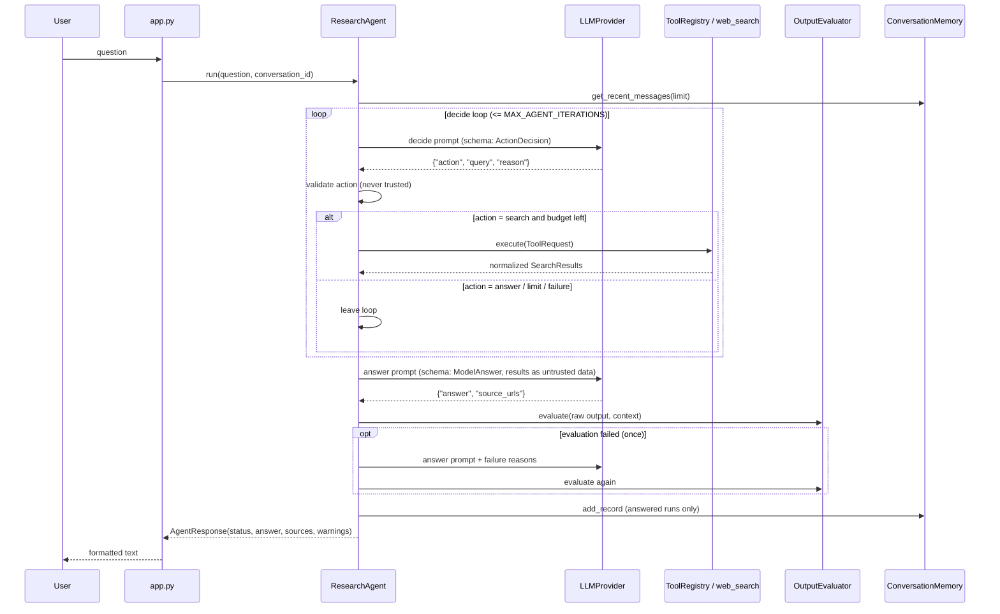

# Architecture

This document explains how Mini Research Agent is put together and why. For setup and usage see the [README](../README.md).

## Component responsibilities

| Component | Owns | Does not own |
|---|---|---|
| `app.py` | CLI parsing, prompts, printing, wiring objects together | Any agent decision |
| `agent.py` | The workflow, limits, fallbacks, repair, saving | HTTP calls, file I/O, SDK details |
| `providers/` | One method: `generate(system_instruction, prompt, response_schema, temperature) -> str`, plus SDK error translation | Prompts, validation |
| `tools/` | `Tool` interface, `ToolRegistry` (allow-list), `WebSearchTool` (Tavily call + normalization) | Deciding *when* to search |
| `evaluator.py` | Deterministic checks of the raw answer | Generating or fixing answers |
| `memory.py` | JSON persistence, id validation, corruption handling | What goes into prompts |
| `config.py` | Environment parsing/validation, logging setup, secret redaction | |
| `models.py` | Pydantic data shapes | Behavior |
| `errors.py` | Exception hierarchy | |

Dependencies point inward: `app -> agent -> {providers, tools, evaluator, memory, models, errors}`. `agent.py` only sees the `LLMProvider` and `Tool` interfaces, which is why the test suite can replace the model and the search service with small fakes.

## Data flow



## Agent decision-making

The model never calls tools directly. It proposes one of two actions as JSON:

```json
{"action": "search", "query": "recent AI automation trends for small businesses", "reason": "needs current information"}
{"action": "answer", "query": "", "reason": "general knowledge is enough"}
```

**Why structured JSON instead of native function calling?** It keeps all validation and execution in application code, keeps the provider interface to a single method, and works the same way with any provider that can produce JSON. The cost is that the model's output must be validated, which the agent does on every response.

`ResearchAgent._parse_action` accepts an action only if:

- the output parses as a JSON object (an optional Markdown fence is stripped),
- `action` is exactly `answer` or `search` (case-insensitive, whitespace-trimmed),
- for `search`: `query` is a string, non-empty after whitespace normalization, at most `max_query_length` characters, and not a repeat of an earlier query.

A rejected action is **not** ignored: it is logged, the model is told the reason on the next attempt, and it counts toward `MAX_INVALID_ACTIONS` (2 per question). The second invalid action ends the run with a controlled failure.

**Stopping conditions** (each is explicit and tested):

| Condition | Outcome |
|---|---|
| Model returns `answer` | Go to answer generation |
| Search limit reached (`MAX_SEARCH_CALLS`) | Do not execute; warn; answer from gathered results |
| Search tool fails | No retry; warn; answer without research; `partial` |
| `MAX_AGENT_ITERATIONS` reached | Warn; answer from gathered results; `partial` |
| 2 invalid actions | `failed` |
| Provider error | `failed`, nothing saved |

In **limited mode** (no search key, or `MAX_SEARCH_CALLS=0`) the decide step is skipped entirely, because there is nothing to decide, and the answer prompt states that no research is available.

## Tool execution

1. The validated query becomes a `ToolRequest(tool_name="web_search", query=...)`. The tool name is set by the application, not by the model.
2. `ToolRegistry.execute` rejects unknown names and unavailable tools (`InvalidToolRequestError`, `ToolUnavailableError`).
3. `WebSearchTool.run` re-validates the query (defense in depth), calls Tavily with `max_results` (and `timeout` when the client method declares it), and translates exceptions into `ToolTimeoutError` / `ToolExecutionError` / `ToolUnavailableError` without leaking raw exception text.
4. Results are normalized to `SearchResult(title, url, snippet, score, published_date)`: unsafe URLs (non-http(s), credentials, whitespace, over-long) and duplicates are dropped, snippets are truncated, the count is capped.
5. The agent merges results (de-duplicated by normalized URL) and passes them to the model inside `<search_results>` tags as **data**. Closing tags in result text are replaced so a page cannot break out of the block, and the system instruction forbids following instructions found there.

## Memory persistence

`ConversationMemory` stores `data/<conversation_id>.json`:

```json
{
  "conversation_id": "…",
  "created_at": "2026-11-01T12:00:00+00:00",
  "records": [
    {
      "record_id": "…", "conversation_id": "…",
      "question": "…", "answer": "…", "status": "completed",
      "created_at": "…",
      "tool_metadata": {"queries": ["…"], "source_urls": ["…"], "searches_performed": 1,
                        "limited_mode": false, "evaluation_passed": true}
    }
  ]
}
```

- **Atomic write:** write a temp file in the same directory, `flush` + `fsync`, `os.replace`. If anything fails the temp file is removed and the old file stays.
- **Corruption:** unreadable or structurally invalid files are renamed to `<id>.json.corrupt-<timestamp>` and treated as empty, so a bad file neither crashes the agent nor gets silently overwritten.
- **Idempotency:** `record_id` is unique per run; a repeated save is skipped.
- **Bounded:** history sent to the model is limited by `MAX_HISTORY_MESSAGES`; each file keeps at most 200 records.
- **Scope:** local, single-user, no locking.

## Evaluation

Evaluation is deterministic and independent from generation. The agent builds an `EvaluationContext` (retrieved sources, URLs from the user's own question, length limit) and `OutputEvaluator.evaluate(raw_output, context)` returns `passed`, `checks` and `issues` (see README for the six checks).

Handling of a failure:

1. Regenerate **once**, giving the model the concrete issues.
2. Re-evaluate. If it passes, the response is `completed` with a note that it was regenerated.
3. If both attempts fail, the less severe result is kept (ties go to the newer one):
   - **Severe** failures (`well_formed`, `non_empty`, `no_false_search_claims`, `urls_from_search_results`): status `failed`, answer withheld. These indicate malformed output, nothing to show, or a misrepresentation of provenance.
   - **Soft** failures (`within_length_limit`, `research_sources_present`): status `partial`, the answer is shown with an explicit warning that it did not pass all checks.
4. If the regeneration call itself fails with a provider error, the first result is used under the same rules.

The evaluator checks structure and source honesty only. It does not verify facts.

## Error propagation

```text
SDK / network exception
   └─ translated at the boundary (GeminiProvider.translate_exception, WebSearchTool._translate_exception)
        └─ ProviderError / ToolError subclasses (user-safe messages, no secrets)
             └─ ResearchAgent decides: fallback (search errors) or abort (provider errors)
                  └─ AgentResponse(status, error / warnings)   <- returned, not raised
                       └─ app.format_response -> terminal text
```

- Translation happens at the **edge** (provider and tool), so the agent reasons about *kinds* of failure, not SDK classes.
- `ResearchAgent.run` catches `AgentError` and returns a `failed` response; it does not catch arbitrary exceptions, so programming errors are visible. The interactive CLI has a single last-resort handler that logs the traceback and keeps the session alive.
- User-facing messages are curated and never include raw exception text, which could contain sensitive data.
- Logs carry the exception *type*, status codes and sizes. A redacting formatter removes known secret values from every log line, including tracebacks.

## Logging

Logger names are under `mra.*`; output goes to a rotating `logs/agent.log` (falls back to stderr if the file cannot be opened). Events are logged as `event=<name> key=value`, for example `app_started`, `question_received`, `action_selected`, `tool_started`, `tool_succeeded` / `tool_failed`, `evaluation_passed` / `evaluation_failed`, `repair_attempt`, `memory_saved`, `workflow_terminated`. Question and answer text are not logged; search queries appear only at `DEBUG`.
